Full-stack engineer in Lviv. At Kevych Solutions I'm the main backend developer on client mobile products: an AI fitness coaching app, a kids' streaming app with subscriptions, and a community app that's already live. That code is private, so the pinned repos below are what you can open.

<b>Projects you can open</b>

| Project | What it is | Stack |
|---|---|---|
| [Aegis](https://github.com/Mykyta135/aegis-humanitarian-platform) | My Bachelor's thesis. Coordinates humanitarian aid missions: live volunteer map over WebSockets, route planning, role-based access | NestJS · TypeORM · PostgreSQL · Next.js · Socket.IO · Docker |
| [MacroTrade](https://github.com/Mykyta135/macrotrade) | Forex swing dashboard: scores pairs through a macro → intermarket → sentiment cascade, AI-written daily reports, hand-rolled KNN | NestJS · PostgreSQL · Next.js · Claude |
| [Супутник у залі](https://github.com/Mykyta135/silpo-shopping-companion) | Hackathon: AI in-store shopping companion on Silpo's MCP server, from receipts to a store-zone route | NestJS · MCP · AI SDK · Expo · Turborepo |
| [Money manager](https://github.com/Mykyta135/money-manager) | Local-first finance tracker I use daily: bank API sync, PDF statements, a phone app that reads bank pushes, an MCP server | Next.js · Drizzle · SQLite · Expo |
| [Garmin dashboard](https://github.com/Mykyta135/garmin_mcp) | Fork of an open-source Garmin MCP server + my SQLite snapshot, morning brief and training dashboard | Python · SQLite · Next.js · Recharts |
| [NestHexagonalTemplate](https://github.com/Mykyta135/NestHexagonalTemplate) | NestJS starter with ports & adapters, plus Hygen generators that scaffold a whole module | NestJS · TypeORM · Hygen |
| [CTF_Bot](https://github.com/Mykyta135/CTF_Bot) | Telegram bot I built for BEST::CTF 2024, the first offline CTF in Lviv: registration, teams, admin approval | TypeScript · Prisma · MongoDB · Zod |
| [CTF_Website](https://github.com/Mykyta135/CTF_Website) | The website for the same event | Next.js · Tailwind |
| [DynamicQueryParams](https://github.com/Mykyta135/DynamicQueryParams) | NestJS decorators for pagination, sorting and filtering from query params | NestJS |

In November 2026 I reviewed these repositories for security before putting them on my CV: secret scans of the full history, authorization checks route by route, fixes with tests. What I found, fixed and left as a known limit is in each repo's `SECURITY.md`. Old coursework I did not fix is archived.

<picture>
  <source media="(prefers-color-scheme: dark)" srcset="https://raw.githubusercontent.com/Mykyta135/Mykyta135/output/snake-dark.svg">
  
</picture>

The card above is rebuilt every night by <a href="scripts/neofetch.ts">a small TypeScript script</a> and GitHub Actions.
